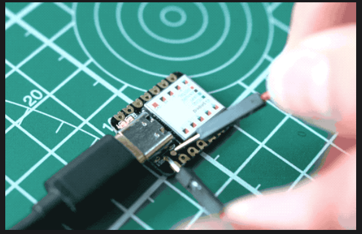
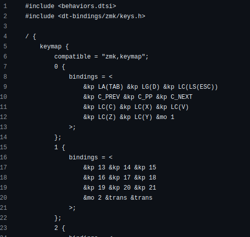
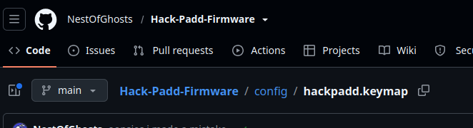
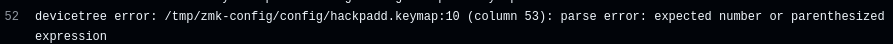

SCREW YOU HALF LIFE REVIEWERSSS >:(

# HackPadd

## A spinoff of a [Hackpad](https://hackpad.hackclub.com/)(A macropad/small keyboard), made by me, for [Hack Club Half Life](https://halflife.hackclub.com/)

## Disclaimer: Havent built this in real life yet. Take this guide as a guide, or wait a couple weeks for me to build it myself

PLACEHOLDER, ADD FINAL PRODUCT IMAGE

I assume you're reading this to make your own. The repos comes in 3 parts: the [chassis](./Chassis%20Cad/) (box you put the pcbs) (3d print/other manufacturing process to make this), the [pcb](./Pcb%20Files/) (Buy from custom pcb seller), and the firmware (the software that translates keystrokes into signals for the computer). It cost around 52~ dollars for me to make.

### Buy the parts

To see more in depth Bill of Materials and costs check [the bom](./bom.md) 

- Seeduino Moudle Xiao: the microcontroller that holds the firmware (I'm getting mine from [digikey](https://www.digikey.ca/en/products/detail/seeed-technology-co-ltd/102010328/11506471)). Make sure that the one you get has pins so that you can solder it onto the board

- 12 1N4148 diodes (im getting from [digikey](https://www.digikey.ca/en/products/detail/onsemi/1N4148/458603)).

- Chassis: 3d print it ideally. You can use other ways to make a box with a plate to hold the keys, but you may need to edit the 3d models to accomadate for your method. If you dont have a 3d printer you should look around your local area for a print farm. I'm getting mine printed in JLC3DP. You can print it with the .step file in [Chassis Cad](./Chassis%20Cad/chassis.step)

- Pcb: Find a pcb printing company and buy one from them based on the gerber files in [Pcb Files](./Pcb%20Files/). I'm getting mine from PCBWay. Ideally use 1.6mm thick pcbs

- 12 Keyswitches + Keycaps: I just got mine from amazon, make sure they work with cherry mx 3 pins

- You're also going to need to know how to solder, and own a soldering iron

### Assembly

1. Flash the [firmware](./Firmware/hackpadd.uf2): 
    - Download the file (extract if needed)
    - Connect the moudle xiao to your computer
    - Short the two rst pins on the seeeduino twice in succession to put it into bootloader mode
     

    (for more info on this step go to [seeduino's wiki](https://wiki.seeedstudio.com/Seeeduino-XIAO/) and scroll down until you see "Enter Bootloader Mode" and "For Xiao SAMD21")
    - A new drive should appear in your file manager. Simply move the .uf2 file into the Seeduino and wait for the file to disappear. When you can no longer see the uf2 the firmware is loaded
2. Solder the Xiao onto the pcb
    - If you don't know how to solder, I recommend youtube as a starting point.
    - You *should* only be doing through hole soldering. 
    - Make sure the seeduino is in the right place and orientation.
    - The seeduino should be on the backside of the pcb, near the top to the right (on the back)
    

    (Frontside)
   
    
    
    (Backside)

4. Solder the keys and diodes
    - Diodes on the backside, switches on the front
5. Assemble (actually this time)
    - pcb in chassis, plate on top, insert the tubes in the holes

    wow your did it

### How it works

The macropad has 3 "layers". Basically, the macropad (with 12 keys) has 12 different actions for each key  
[Alt + Tab] [Show desktop] [Task Manager]  
[Previous song/video/media] [Pause] [Next]  
[Copy] [Cut] [Paste]  
[Undo] [Redo] [Hold to access next layer]  

See that "hold to access" key? While holding that key you get access to a new suite of actions  
[f13] [f14] [f15]  
[f16] [f17] [f18]  
[f19] [f20] [f21]  
[Hold to access next layer] [nothing] [nothing, you should already have this key down to access this layer]

Notice another hta key? There's a third layer  
[Bootloader (so you can enter bootloader without needing to short the rst bits)] [nothing] [nothing]  
[Nothing in entire 2nd line]  
[Power off] [nothing] [nothing]  
[You should already be holding this key down] [nothing] [You should already be holding this down].

3 layers :3

### Customization
If you want to make your own key's, you need to make your own firmware. The easiest way to do this is to clone [my firmware repo](https://github.com/NestOfGhosts/Hack-Padd-Firmware), and edit the file config/hackpadd.keymap  
  
(This is what the top of the file should look like)

(Notice how inside of bindings = <> there are 3 columns and 4 rows of characters? They match up to the 3 columns and 4 rows of the macropad.)
The &kp and &mo etc's definition's can be found in [ZMK.dev Docs](https://zmk.dev/docs/keymaps/behaviors), where you can also find other actions you can bind to the keys.

(Notice the 0{
    bindings = <>
}? This is layer one (The 0 is just a name/label i put on the layer. The actual order of layer's is based on it's position in the file))
In the actual .keymap folder you'll see a layer 0{}, 1{}, and 2{}. Feel free to add, delete, or rename the layers. For more info on keymap customization, read [the zmk.dev doc keymap section](https://zmk.dev/docs/keymaps) 

When you're done editing the .keymap, upload your modifications to github. Then, go to the "actions" tab 
  
In the actions tab, you should see the commit(a version of your github repo) you uploaded onto github under "All workflows". Wait for it to finish processing. When it's done processing you should see either a red x or a green checkmark. If it's a green checkmark, click on the commit name, then scroll down to "artifacts", where you should find a firmware file. 

Simply download and extract the file, and you get your very own customized .uf2

If it was a red x, it means that the firmware builder failed. If you're a beginner I recommend asking someone/ai for help, but the main error you would encounter is under "West Build (hackpadd-seeeduino_xiao//zmk)". Simply scroll through the error message until you find a message that says: 
 (Prolly with different numbers) or something similar.  
In my case, it means that there's a typo that starts in line 10, 53 characters to the right. To fix the typo, just match the different elements in that line of code to the example code in the [ZMK.dev Docs](https://zmk.dev/docs/keymaps/behaviors).

If it's something else, ask someone/ai. If you're in hack club, you can try asking someone in the hack club slack.

If instead you wanted to customize the hardware (more/less keys, change layout, change drawings), I recommend just following the guide at [Hackpad.Hackclub](https://hackpad.hackclub.com/) to make your own, cause the existing hardware is an invention of a me from the past, and I cannot decipher his work.
